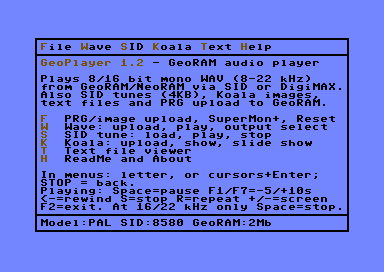

# GeoPlayer

A Commodore 64 audio player and file toolbox for the **GeoRAM** expansion cartridge.

GeoPlayer turns a GeoRAM unit into a playback medium: wave files, SID tunes,
Koala graphics, PRG programs and generic binary files can be uploaded from disk
into the GeoRAM and then used directly from there.



## Features

- **Wave player** — uploads and plays PCM wave files stored in GeoRAM
  - 8 or 16 bit, mono
  - sample rates: 8, 11, 16 or 22 kHz
  - output through the **SID** (with 4-bit dithering) or a userport **DigiMax**
  (based on the TLC7226, four 8-bit D/A converters)
  - playback controls: pause/resume, seek, rewind, stop, screen on/off, repeat
- **SID player** — loads SID files at address `$1000`, showing title and author
- **Koala menu**
  - uploads up to **10 Koala images** into GeoRAM
  - slideshow with `space` (next picture) and `q` (exit)
  - single image viewer
- **File menu**
  - **PRG uploader** — uploads programs (e.g. games) into GeoRAM; start them
    with `SYS 57000` after a reset, then `RUN`
  - **Bin uploader** — uploads any file into GeoRAM
- **SuperMon+64** — Jim Butterfield's machine language monitor, relocated at
  `$3400` (`X` returns to GeoPlayer)
- **Text viewer** — reads text files with a `-MORE-` pager
- Starts with a simple `RUN` (BASIC stub included, entry point `$4000`)

## Requirements

- A Commodore 64 (real hardware or emulator such as VICE)
- A **GeoRAM** expansion (1–4 MB)
- A disk device — **SD2IEC** recommended
- Optional: a userport **DigiMax** adapter (based on the TLC7226, four 8-bit
  D/A converters) for the best sound quality

## Koala images note

`.koa` files must have load address `$6000` (first two bytes `00 60`).
`png2prg` produces files loading at `$2000` (`00 20`): fix the first two bytes
before uploading, otherwise the image check will fail.

## Building

Build with [cc65](https://cc65.github.io/) (tested with current master):

```sh
cl65 -v -t c64 -T -O -I include -C geoplay.cfg \
    geoplayMain1.2.c screen.c filedlg.c utility.c dir.c \
    geoplay-asm1.2.s -o GeoPlayer1.2.prg
```

## Credits

- **Greg Nacu** — for his excellent DigiPlay routine and the support
- **Thomas Giesel** — for the GeoUploader source code
- **Richard Bayliss** — for the "I Love DMC" tune
- **Mistral AI** — for the bug fixes and the code cleanup :)
